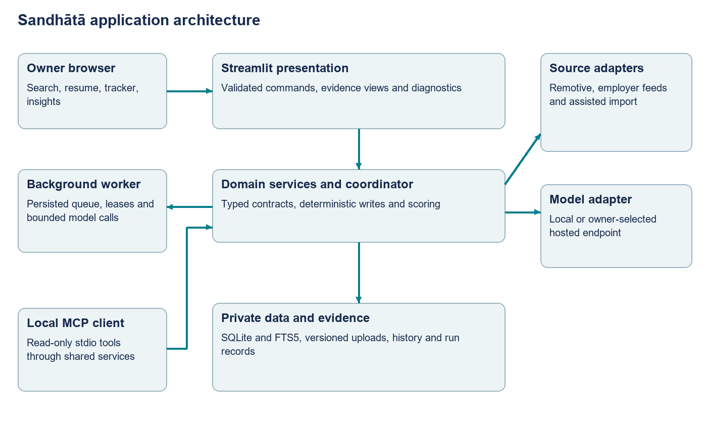
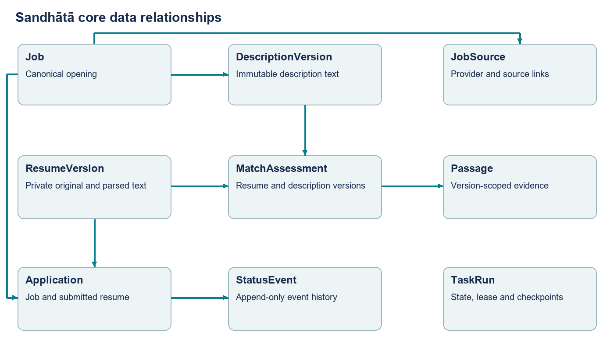

# Sandhātā Low Level Design and Architecture

Version 0.1 | October 26 2026 | Prepared for Hema Chepuri | Design baseline

This document specifies the intended implementation. Application code, test results, live integrations, GitHub publication and production deployment are not established by this document. Dates are delivery targets in America/New_York, subject to the release gates.

## Architecture decision

Use one Python application with Streamlit presentation, domain services and a bounded LangGraph workflow. SQLite with FTS5 stores structured records and searchable passages; a private file directory holds resume originals. A separate worker process polls durable tasks so Streamlit reruns do not duplicate work. One database writer transaction at a time is sufficient for the personal-use workload.



The browser calls presentation functions, which validate typed commands and invoke services. Services own database transactions. Agents receive read-only evidence and return schema-validated proposals. Only deterministic services update tracker state. External content cannot issue commands or select tools. Hosted deployment places authentication and TLS before the application; the application port is not publicly reachable.

## Proposed source layout

```text
sandhata/
  app.py                    Streamlit navigation and page composition
  src/sandhata/
    config.py               validated environment and paths
    domain/                 Pydantic commands and results
    db/                     SQLAlchemy models and migrations
    services/               intake, matching, tracker and analytics
    connectors/             remotive, employer feeds and manual imports
    agents/                 coordinator, intake, resume, fit and career
    retrieval/              passage indexing and evidence lookup
    worker.py               persisted task polling and leases
    mcp_server.py           read-only stdio adapter
  tests/                    unit, integration and UI cases
  evals/                    synthetic fixtures and result records
  deploy/                   container and private-host configuration
```

These paths describe intended application code. The initial document package does not claim they exist.

## Data model

All IDs are UUID strings; timestamps are UTC ISO 8601 and converted to the owner's display timezone. Foreign keys are enabled. Resume text is private. Database files and uploads never enter Git.

| Entity | Key fields and constraints |
| --- | --- |
| SearchProfile | id, label, filters_json, hard_filters_json, version |
| Job | id, normalized title/company, location, workplace type, active state |
| JobSource | job_id, provider, provider_job_id, original_url, employer_url, last_seen; unique provider and provider_job_id |
| DescriptionVersion | id, job_id, raw_html, plain_text, hash, fetched_at, completeness, provenance |
| ResumeVersion | id, label, hash, private file path, parsed text, parser_version, created_at |
| Passage | id, parent_type/id/version, section, offsets, text; FTS document |
| MatchAssessment | id, resume_version_id, description_version_id, rubric/model/prompt versions, evidence_json, score, coverage |
| Application | id, job_id, resume_version_id, status, applied_at, notes; one current tracker item per job |
| StatusEvent | id, application_id, previous/new status, occurred_at, recorded_at, request_id, actor |
| TaskRun | id, kind, state, lease_until, attempts, checkpoint, error_code, trace_id |
| FollowUp | id, application_id, due_at, completed_at, user text |



## Service contracts

search_jobs(profile_id, refresh=False) returns jobs, source outcomes and freshness. import_job(source, url, description, request_id) returns a canonical job and description version. upload_resume(bytes, filename, label) returns a resume version and parse report. compare(job_id, description_version_id, resume_version_id, request_id) returns a task ID. update_status(application_id, new_status, occurred_at, request_id) returns a status event. search_saved(query, filters, limit) returns typed evidence. All outputs distinguish success, partial, unavailable and invalid input.

Request IDs make writes idempotent. Repeating a comparison with identical version and policy inputs reuses a valid cached result. A stale source snapshot is never silently substituted for a new description.

## Fit contract and arithmetic

Extract atomic requirements with category, importance, job quote and offsets. Match each to a resume quote with offsets and status supported, partial, not_evidenced or unknown. Validate quotes against stored text. Supported earns 1, partial earns 0.5, not_evidenced earns 0. Unknown has no asserted score and reduces evidence coverage.

Default category weights are required skills 40, responsibilities and experience 30, preferred skills 15, explicit education or certification 10, and domain 5. Categories absent from the job are omitted and remaining weights renormalized. Within each category use equal atomic requirement weights for rubric v1. Overall score is 100 times the weighted fraction supported over assessed weights. Coverage is assessed weight divided by all applicable requirement weight. Below 80 percent coverage or with incomplete description, show a provisional score; below 50 percent suppress the overall percentage and show evidence only. A missing resume statement is not proof that the user lacks a skill. Eligibility constraints are independent pass, fail or unknown flags and do not disappear inside the average.

## Transactions and failures

Import validates then inserts canonical/source/version/index changes in one transaction. Resume file is written to a temporary path, hashed, parsed, then atomically moved with compensating cleanup on database failure. Tracker update and history append share one transaction. Worker claims tasks using a lease; a crash expires the lease and bounded recovery retries the task. SQLite uses WAL, busy timeout and a local persistent disk; never put the live database on shared network storage.

## Security and operating limits

Uploads allow text PDF and DOCX, maximum 10 MB and 50 pages as initial configurable limits. Reject mismatched magic types, encrypted files and oversized archives. Render escaped text or sanitized HTML without script execution. Fetch only supported HTTPS connector endpoints; validate redirect destinations and block private/local addresses for user URLs. Set initial request timeout 15 seconds, two retries with jitter, max 50 candidates and 20 model comparisons per run. These are configuration defaults to validate, not measured capacity.

## Architecture tradeoffs

SQLite and a single host lower setup cost but do not provide horizontal scaling or high availability. Migrate to PostgreSQL before multiple app replicas. Streamlit accelerates the workflow; a React frontend becomes a separate decision if the visual acceptance gate cannot be met. FastAPI is deferred because v1 needs no independent public API. The MCP adapter calls the same services and does not add a second business implementation.
