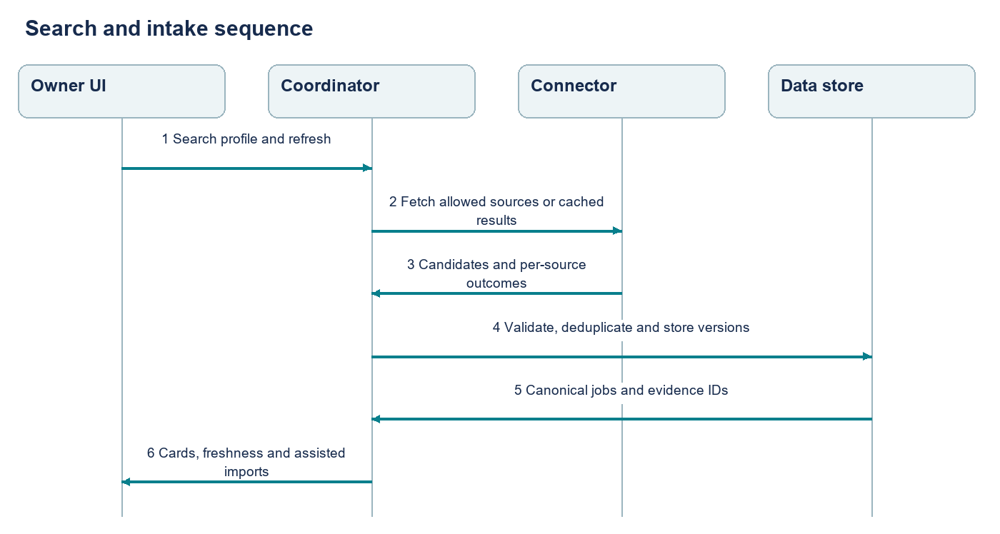
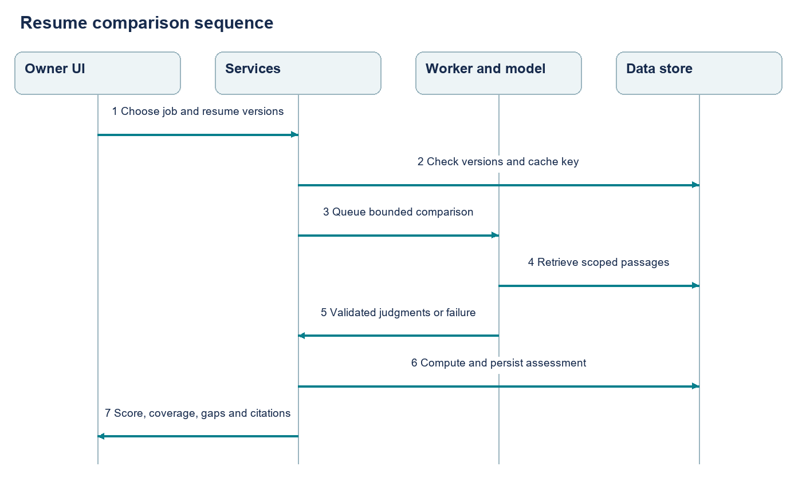
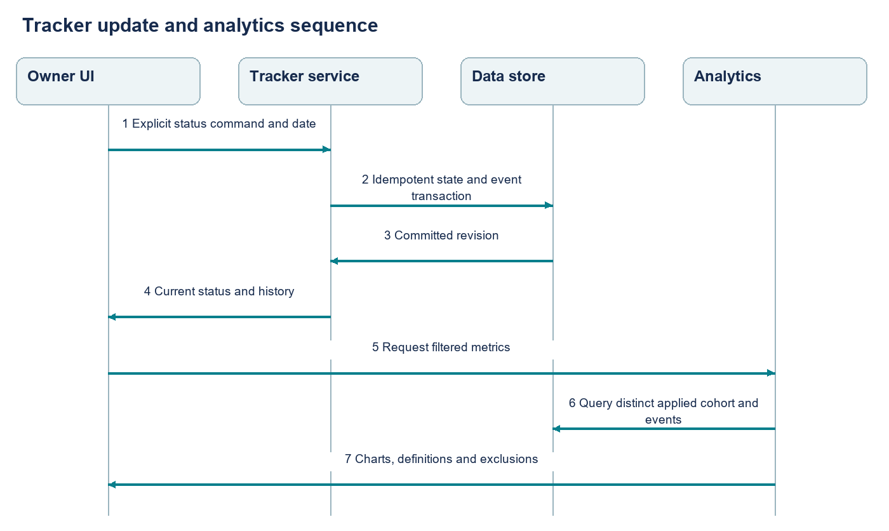

# Sandhātā Sequence Flows

Version 0.1 | October 26 2026 | Prepared for Hema Chepuri | Design baseline

This document specifies the intended implementation. Application code, test results, live integrations, GitHub publication and production deployment are not established by this document. Dates are delivery targets in America/New_York, subject to the release gates.

## Flow conventions

The diagrams describe proposed runtime behavior. Solid calls are synchronous service work; a queued task ID separates long model processing from UI refreshes. Each operation uses a request or trace ID. Source failures produce partial results rather than discarding successful connectors.

## Search and import

1. User saves hard constraints and ranking preferences, then requests refresh.
2. Coordinator loads the profile and connector capabilities. Remotive refresh uses the source cache and rate policy; manual-only sources receive external search links and an import form.
3. Connectors return provider IDs, source URLs, descriptions and retrieval metadata. Job Curator validates, normalizes and merges exact provider duplicates. Cross-source fuzzy matches are suggested unless strong employer/requisition evidence supports merging.
4. One transaction writes sources, original description versions and searchable passages. Cards show source, last checked time, completeness and missing fields.
5. Failure path: timeout records an error and retains the prior cache with a stale label. A login wall returns assisted import, not fabricated text.

## Resume comparison

1. User chooses a specific job description and resume version.
2. Service verifies both exist and are not pending deletion. A unique cache key includes content hashes, parser, rubric, prompt and model version.
3. Worker retrieves evidence only from the selected versions. Fit Analyst emits atomic requirements, evidence and uncertainty.
4. Validator confirms quote offsets, schema and category membership. One repair attempt is allowed; continued invalid output fails the task.
5. Scoring code computes alignment and coverage. The stored result retains the complete evidence trail. A model outage leaves the job and tracker usable and exposes retry.

## Tracker update and analytics

1. User changes status, supplies event date and selects the resume used when applying.
2. Service validates the command and detects duplicate request IDs. It supports revisiting a status with a new event; it does not delete previous history.
3. Transaction updates current application state and appends the event. Applied date is stored separately and is not inferred from link clicks.
4. Analytics reads committed events and updates charts for the selected date cohort. Explanations use computed aggregates with metric definitions.

## Retrieval and MCP

A local MCP client calls search_saved_jobs or get_job_detail. The adapter validates bounded arguments and invokes read-only services. Retrieval filters owner and selected entity/version before ranking, returns passage IDs and citations, and refuses unavailable records. The assistant answers from evidence or says the record does not establish the answer. Local MCP has no status mutation or automatic application tool in v1.

## Delete and restore

Deleting a resume removes its original, parsed text, passages, checkpoints and dependent private match evidence from active storage. Application history may retain a tombstoned resume label without content. Backup expiry and restore-time deletion replay prevent reintroducing deleted content. A restore uses a stopped app or a consistent SQLite backup; integrity and representative file hashes are checked before the worker restarts.
