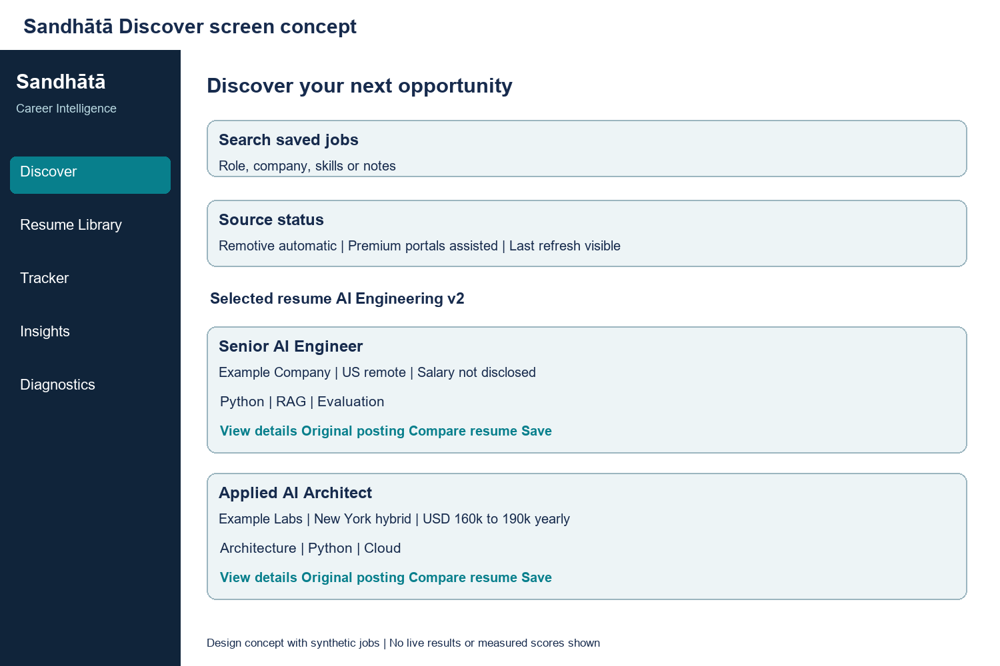

# Sandhātā UI Design and User Guide

Version 0.1 | October 26 2026 | Prepared for Hema Chepuri | Design baseline

This document specifies the intended implementation. Application code, test results, live integrations, GitHub publication and production deployment are not established by this document. Dates are delivery targets in America/New_York, subject to the release gates.

## Visual direction

Use the display title Sandhātā and the subtitle Career Intelligence. SANDHĀTĀ expands to Search, Analyze, Navigate, Discover, Highlight, Apply, Track, Advance. The acronym appears in About and onboarding rather than crowding every screen. The application helps organize the user's applications; it does not submit them automatically.

The concept is a design mockup, not a running application screenshot. Use navy #10243A for navigation, teal #087F8C for primary actions, background #F5F7FA, white content surfaces and dark text #172B4D. Use amber for qualified warnings and red for errors with text labels. Typography uses an accessible system sans serif with 16 pixel-equivalent body text, clear headings and tabular numbers for metrics. Verify contrast rather than assuming palette choices pass.

## Navigation and information hierarchy

The sidebar contains Discover, Resume Library, Tracker, Insights and Diagnostics. Global search is visible at the top. A compact source health strip explains automatic versus assisted sources and last refresh. Main job cards show title, company, location/workplace, salary with units, skills, source, posting date when known, retrieval age and completeness. Fit appears only after selecting and comparing a resume.

## Discover and job detail

Enter a search profile, separate must-have constraints from preferences, and run supported-source search. External search buttons open premium portals in the user's browser. Import opens a form for source, URL and full pasted description, then previews extracted fields before saving. Pasting a URL alone does not promise full retrieval.

Select a card to open Details. Tabs show Original Description, Requirements, Resume Fit and Tracker. Original wording remains distinct from AI summaries. A citation opens the stored passage and highlights its evidence; the original posting is a separate link. Explain unknown salary and partial descriptions visibly. A stale-source warning retains the cached record without implying the job is still open.

## Resume library and comparison

Upload PDF or DOCX, assign a label and review parsed text. Select a version explicitly before comparing. The Fit view shows category breakdown, evidence coverage, eligibility flags, matched requirements and not-evidenced items. Provisional scores explain their limitation. Resume guidance may recommend clearer wording supported by existing evidence; it must not invent credentials or experience.

## Tracker and insights

Use a filterable table first; a board is optional if the timebox permits. Status changes request event date and optional note. Opening Apply leads to the original site; the user later records Applied. History is available in Details. Insights provides date cohort filters, metric explanations, readable charts and downloadable tables. No-data charts explain how records will populate them.

## State and accessibility specification

Empty states show the next action and no invented sample statistics. Loading states show current operation and preserve prior committed results. Errors retain input, explain the failed action and offer a bounded retry. Buttons and focus order are keyboard accessible. Status has text and icon, not color alone. At 390 pixels, cards stack and wide tables scroll with clear headings. Long role titles wrap without clipping. Charts have text/table alternatives and descriptive titles.

## UI acceptance and design constraints

Use supported Streamlit composition and theme configuration before fragile DOM-specific CSS. Measure perceived quality with owner review at desktop and mobile widths. The design gate checks consistent spacing, hierarchy, typography, evidence visibility and the complete workflow. If Streamlit cannot meet this gate, estimate a React implementation openly rather than promising a same-day replacement. Screenshots use synthetic records only.
