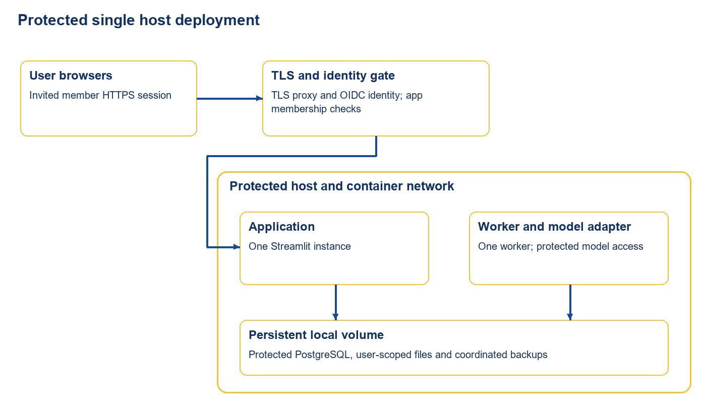

# SANDHĀTĀ Production Deployment and Release Guide

Version 0.2 | October 26 2026 | Prepared for Hema Chepuri | Design baseline

This document specifies the intended implementation. Application code, test results, live integrations, GitHub publication and production deployment are not established by this document. Dates are delivery targets in America/New_York, subject to the release gates.

## Deployment target and claim boundary

The baseline production target is a single protected Linux host running one application instance and one worker, a protected PostgreSQL service, and protected file storage. AWS is the selected provider; account, domain, identity configuration and budget remain to be resolved. Document 24 provides the AWS foundation and deployment sequence. This document is a deployment specification; it is not evidence of a deployed service. A protected local pilot can precede hosted production.

## Runtime topology

Caddy or an existing TLS reverse proxy routes browser traffic and WebSocket upgrades to Streamlit. Streamlit performs the OIDC sign-in and the application performs membership and role authorization; a proxy login is not a substitute for these service checks. Restrict access to invited, active user identities; the app resolves membership and roles after OIDC sign-in. Bind the application to a protected container network; expose only the proxy. Keep the worker and model endpoint protected. Local stdio MCP is not exposed over the public network.

Mount persistent data at /data for database, uploads and safe operational state. Use PostgreSQL on a protected network with persistent database storage, migrations and forced RLS. Keep uploads in protected storage using tenant/user/opaque-ID keys. Container restarts must retain both stores. Database dumps and originals never enter the image or repository. Additional app replicas require a shared protected object store, session strategy and a revised capacity test.

## Configuration contract

| Variable | Purpose | Handling |
| --- | --- | --- |
| SANDHATA_DATA_DIR | Persistent protected data root | Required outside source tree |
| SANDHATA_MODEL_PROVIDER | Local or configured hosted adapter | Validated allowlist |
| SANDHATA_MODEL_NAME | Model identity | Recorded with assessments |
| SANDHATA_MODEL_BASE_URL | Model endpoint | Protected network preferred |
| SANDHATA_MODEL_API_KEY | Hosted credential if needed | Secret injection; never log |
| SANDHATA_TIMEZONE | Display and analytics timezone | America/New_York default |
| SANDHATA_LOG_LEVEL | Operational verbosity | No raw content at any level |
| SANDHATA_REMOTIVE_REFRESH_HOURS | Cache interval | At least six hours for scheduled refresh |

These are proposed settings to implement and validate. Keep runtime secrets out of .env.example. A local model on another machine needs authenticated protected connectivity and compatible capacity; it is not implicitly available in the container.

## Release procedure

1. Select host, access mode and model; confirm invited-user access, admin bootstrap and storage paths.
2. Check out the verified release SHA; install the exact dependency lock or build the pinned image.
3. Stop writes, create a consistent backup and apply migrations in a one-time release step.
4. Start application and worker under non-root accounts with constrained file permissions.
5. Validate health endpoint, proxy authentication, WebSocket traffic, file permissions and model reachability.
6. Run the synthetic import, comparison, tracker and chart smoke tests through the deployed UI.
7. Restart both containers and verify persistence. Restore a backup to a separate location and verify integrity.
8. Record deployment URL securely, SHA/image digest, migration version, smoke results and rollback target.

## Backup and rollback

Use a consistent PostgreSQL dump/base-backup strategy and a coordinated file manifest. Pause writes during the initial simple user backup procedure so database and file snapshots describe the same state. Include identity-provider configuration backups separately when self-hosted. Capture uploads and database consistently, encrypt backup storage and retain seven daily copies initially. Proposed recovery objectives are at most 24 hours of data loss and two hours to restore; prove them with a timed drill. Reapply deletion tombstones on restore. Roll back the application image only when schema compatibility is known; otherwise restore the matching database/files backup and disclose the data-loss interval.

## Health and security gate

Use Streamlit's documented health path for process readiness and a worker heartbeat for task processing. Model availability is a separate dependency state. Verify unauthenticated requests cannot read pages or uploads; access logs contain no tokens or resume data. Confirm durable storage, disk headroom, backups and manual recovery instructions. Do not call the deployment production-ready until these checks have actual results.

## Evidence and ongoing ownership

Release evidence includes CI/test/eval summaries, owner walkthrough, restore log, authenticated UI check, immutable commit and known limitations. The owner operates credentials and backup access. A failed critical check leaves the release candidate unpromoted. No automatic infrastructure purchase or public exposure is required by this document.

## User deployment and migration gate

Add OIDC issuer/client ID, redirect URI, cookie secret and client secret through validated secret configuration. Configure first-admin issuer/subject out of band; no shared user password or default administrator password is allowed. Set database application and migration credentials separately; the application role cannot bypass RLS. A self-hosted Keycloak deployment requires its own database/schema, backup plan, TLS configuration and upgrade ownership.

Before user access, verify two members and an administrator, denied uninvited access, invitation redemption, session revocation, forbidden cross-user URLs, protected downloads, cache scoping, member/admin navigation and five concurrent sessions. Test worker access after suspension and RLS with the actual runtime database role. The deployed health check must distinguish app, worker, database and identity-provider availability.

The local pilot already uses PostgreSQL. If older protected records are imported from a separate prototype, stop writes, back up, map every protected row to an explicit member, import into PostgreSQL, validate ownership and counts, and retain a rollback snapshot. Never assign legacy protected records to all members or infer ownership from filenames.

Restore is offline/operator-controlled. Preserve deletion tombstones and suspension/auth-version changes so older backups cannot reactivate accounts or resurrect erased content. After restore, rerun account access checks before reopening traffic. Revoke stale application sessions and background task capabilities.
