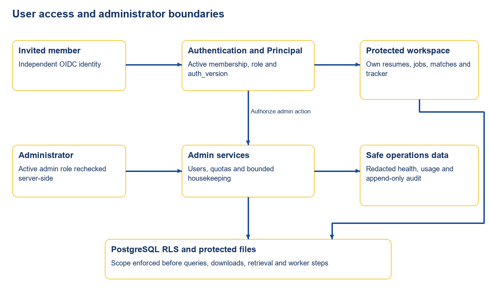

# SANDHĀTĀ Administrator and User Access Guide

Version 0.2 | October 26 2026 | Prepared for Hema Chepuri | Design baseline

This guide specifies the target user and administrator operating model. A local pilot now implements its core account, authorization and housekeeping flows. Document 23 identifies the tested subset and remaining production gates; capabilities described here are not automatically release claims.

## Operating model

One user household contains invited members with individual protected workspaces. Administrators can also use their own career workspace. There is no public registration, shared user login or routine administrator impersonation. The initial tested capacity target is ten accounts with five concurrent sessions, subject to measured validation.

## Permission matrix

| Capability | Member | Administrator |
| --- | --- | --- |
| Own resumes, jobs, matches and tracker | Manage own records | Manage own records |
| Another member's career content | Denied | Denied in routine application flows |
| Member list and account state | Own account only | View safe household account metadata |
| Invitations and activation | Redeem intended invitation | Create, expire and revoke invitations |
| Roles and suspension | Denied | Manage subject to last-admin protection |
| Quotas and shared source policy | Own usage view | Configure bounded limits and policy |
| Operational diagnostics | Own run outcomes | Redacted household system health |
| Admin audit and maintenance | Denied | Read audit and run allowlisted jobs |
| Direct database or shell access | Not exposed | Not exposed by application |

Application administration is a distinct permission from infrastructure operations. A host/database operator can technically access stored data and backups. Restrict those credentials, encrypt storage, audit operational access and explain this limit to user members. Application privacy is not a promise against an administrator who also controls the host.

## Sign in and onboarding

Use a verified OpenID Connect identity; stable identity is issuer plus subject. Email alone is insufficient to establish ownership. The service validates an invitation's trusted issuer, intended verified email or pre-bound subject, tenant, role, expiry and single-use token. On first redemption it binds the membership permanently to the validated issuer/subject; later email changes never transfer that binding. Store only token hashes and consume invitations atomically to prevent replay. Initial expiry is 48 hours, configurable. Copying a link does not send a message or email automatically.

Configure the first administrator out of band using issuer and subject. No first-user-wins bootstrap or default password is permitted. A member receives only the role on the valid invitation. A role change or suspension increments auth_version, invalidates application sessions and causes queued work to fail its next authority check. Provider cookie logout alone is not the revocation mechanism.

The identity provider owns password resets and multi-factor authentication. Prefer MFA for administrators. The application does not store passwords. Account self-service offers display name, timezone, usage, own export and own deletion request; changing an email does not transfer identity ownership.

## Account lifecycle

Invitations are pending, redeemed, expired or revoked. Memberships are active, suspended or deletion_pending. Keep invitation state separate from membership state. Suspension preserves records but denies protected access; reactivation restores only the existing authorized workspace. Delete is a separate lifecycle action with explicit impact preview.

At least one active administrator must remain. Serialize role/suspension/deletion changes under a tenant-level transaction lock and recheck the active-admin count inside the transaction. Block self-demotion or simultaneous admin removals that would leave the household unmanaged. Emergency recovery uses an audited operator procedure with identity verification; it is not a public reset endpoint.

## Admin Console

Users lists display name, role, state, last activity and resource usage. Invitations lists safe identity metadata, expiry and redemption state without raw tokens after creation. Usage reports storage, uploaded file counts and model calls. System Health reports source freshness, queue/worker health, database connectivity, safe failures and backup age. Audit supports actor/action/date filters. Housekeeping offers previewed maintenance jobs.

All tabs and callbacks resolve active admin authority server-side. Do not rely on hidden navigation or OIDC role claims that may be stale. Default audit and diagnostic views omit resumes, job-search text, protected notes, source credentials and raw model prompts. Per-member operational usage is administratively visible and must be disclosed during onboarding.

## Quotas and resource policy

Initial configurable defaults are 20 resume versions, 100 MB protected upload storage, 50 candidate jobs per search run, 20 model comparisons per run and 100 comparisons per user per day. These are proposed safety limits, not measured provider capacity. Check limits atomically so concurrent sessions cannot overspend them. Admin changes are versioned and audited; completed activity retains the policy used.

Public Remotive data is fetched centrally with a deployment-wide schedule respecting its recommendation of no more than four daily fetches. Protected searches, matches and resumes are not shared in that cache. Each member uses their own premium portal browser sessions; SANDHĀTĀ never stores portal passwords or cookies or claims a user subscription entitlement.

## Housekeeping runbook

| Job | Safe preview and execution rule |
| --- | --- |
| Expired invitations | Revoke expired token hashes; retain safe audit metadata |
| Old logs and checkpoints | Show date cutoff and record count; delete in bounded batches |
| Stale public cache | Invalidate public payloads; preserve protected saved snapshots |
| Failed or cancelled tasks | Recheck membership, retry limits and scope before retry or removal |
| Orphan uploads | Verify no active record references; quarantine before delayed purge |
| Account erasure | Show affected protected object counts; require explicit target confirmation |
| Backups | Show status and initiate a configured backup job; restore remains operator-controlled |

Every maintenance job has a unique request ID, scope, preview timestamp, reason, lease, batch limit, state and result. Confirmation is revalidated against current scope and counts. Ordinary reversible actions need one explicit action; irreversible purge and account erasure require a clear second confirmation identifying the target. Cancellation stops subsequent batches and reports what already committed. Never expose arbitrary SQL, filesystem paths or shell commands.

Keep a recoverable quarantine for orphan uploads for seven days initially. Active record references override cleanup eligibility. Account erasure removes originals, profiles, passages, assessments, checkpoints and personal tracker content from active storage, with a minimal non-content audit tombstone. Retain deletion tombstones until all affected backups expire. Restoring backups replays erasure, suspension and revocation state before traffic resumes.

## Audit retention and incident response

Record actor, tenant, action, opaque target, reason, safe before/after metadata, trace ID, timestamp and outcome. Do not store passwords, invitation plaintext, tokens, cookies or protected career text. Application roles cannot update or delete audit events during ordinary operation. Scheduled audit retention uses a dedicated restricted maintenance role after the 90-day default period.

For suspected account exposure, suspend the membership, revoke application authority and investigate sanitized audit events. For cross-user evidence leakage, disable the affected retrieval/cache path and block user release until fixed and retested. For identity-provider outage, show unavailable and fail closed. For backup failure, preserve current data, warn administrators and follow the recovery guide. No incident action automatically contacts external recipients.

## Acceptance and delivery evidence

Two members and an administrator must complete independent workflows. An uninvited user is denied; a member cannot invoke admin actions directly; admin views expose no protected career content. Guessed IDs, exports, file links, RAG citations, caches, checkpoints and MCP calls remain owner-scoped. Suspension is effective on the next protected operation and worker step. Concurrent last-admin changes preserve one admin. Cleanup retry/cancellation and backup restore are tested.

Record actual commit, test environment, account fixtures, role matrix checks, five-session concurrency results, migration/RLS results and restore evidence. The initial document revision does not establish these passes. If those gates are incomplete, label the build a development preview rather than a user-ready service.
