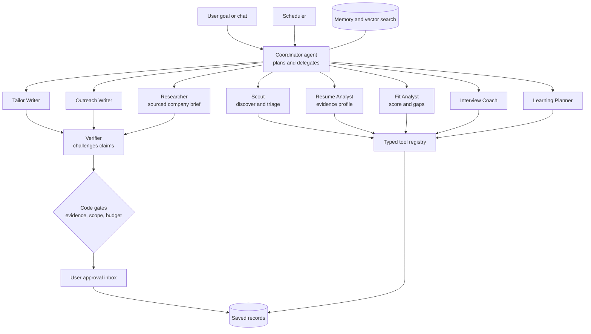

# SANDHĀTĀ Multi-Agent Transformation Proposal

November 26 2026 | D1 approved by the owner and implemented in part (Tailor service and Verifier, no screen); D2 to D4 not yet approved

## 1. Goal

Move from an application with one model step to a team of agents that plans work toward a user goal, uses tools, checks each other's output and works between visits. The user states a goal such as "find and prepare my five best Lead AI FDE roles this week" and approves the results.

**Design principle:** agents decide and draft; code enforces permissions, evidence and budgets; the user approves anything that changes records or reaches another person.

## 2. Today

| Item | Current state |
| --- | --- |
| Model-using agents | Three: Fit Analyst, Tailor Writer and Verifier |
| Planned in guides 16 to 20 | Coordinator, Search and Intake, Resume Analyst, Career Assistant; not built |
| Resume Tailor | Service, worker task, writer, Verifier and compose built and tested; no screen yet |
| Tools | Repository functions and a read-only MCP server |

## 3. What makes it agentic

| Capability | Meaning here |
| --- | --- |
| Goal-driven planning | A Coordinator model turns a goal into steps and revises them when results are weak |
| Tool use | Agents choose from typed, allowlisted tools |
| Reflection | A Verifier challenges drafts; the writer revises once |
| Memory | Preferences, past decisions and outcomes inform later runs |
| Proactivity | Scheduled runs prepare a digest before the user arrives |
| Delegation | Specialists return validated results to the Coordinator |

## 4. Target architecture

## 5. Agent roster

| Agent | What the model decides | Tools | Cannot | Backlog |
| --- | --- | --- | --- | --- |
| Coordinator | Plan, next step, when to stop or ask | Delegate, read records, open approval | Write career records directly | F13 |
| Scout | Search variations, which new postings matter, likely duplicates | Connectors, saved boards, job read | Fetch arbitrary URLs, scrape excluded portals | F02, F04 |
| Intake Parser | Fields in a pasted recruiter message | Prefill tracker form | Save without the user | F10 |
| Resume Analyst | Skills, roles and achievements with quotes | Resume read, passage search | Add facts | Guide 18 |
| Fit Analyst | Requirement-to-evidence judgments | Existing graph | Calculate the score | Exists |
| Tailor Writer | Rewrites and ordering | Segmented units | Apply changes | F06 |
| Verifier | Whether a draft claims more than its evidence | Read draft and evidence | Approve or rewrite; it can only reject or warn | New |
| Outreach Writer | Cover letter and message drafts | Approved evidence | Send | F09 |
| Researcher | Which public sources answer a question | Allowlisted web fetch | Read private data in the same step | F12 |
| Interview Coach | Questions, follow-ups, feedback on answers | Job, evidence, STAR story bank | Invent stories | F07 |
| Learning Planner | Priorities for recurring gaps | Gap groups | Claim a skill as learned | F03, F11 |
| Career Assistant | Which saved data answers a question | Read-only queries | Change the tracker | F08 |

Scoring, metrics, tracker writes, permissions and document composition stay as ordinary code. A model adds no value there and adds risk.

## 6. Changes needed

| # | Change | Detail |
| --- | --- | --- |
| C1 | Shared agent runtime | `src/sandhata/agents/` with a common state, step and time budgets, and a LangGraph supervisor with specialist subgraphs |
| C2 | Tool registry | Typed contracts over repository functions; per-agent allowlist; every call checked against the server-resolved Principal; reuse from MCP |
| C3 | Persisted checkpoints | LangGraph Postgres checkpointer under row-level security so runs pause and resume |
| C4 | Task model | New task kinds, `waiting_approval` state with expiry, leases renewed per step instead of one 10-minute lease |
| C5 | Approval inbox | One screen for every pending action, with evidence; no approve-all for claims about the user |
| C6 | Model routing | Extend `providers.py`: a small local model for routing and parsing, `gpt-oss:20b` for reasoning; hosted models only with per-run consent |
| C7 | Memory and retrieval | pgvector for semantic search; preference memory that is visible, editable and deletable; never treated as resume evidence |
| C8 | Scheduler | Daily Scout and ranking run with a digest on the Today screen |
| C9 | Agent tracing | Run, step and tool-call records with tokens, duration and outcome; a trace view in Diagnostics |
| C10 | Evaluation | Golden set per agent, plus trajectory tests: right tools, no forbidden actions, stops within budget |

## 7. Changes to earlier decisions

| Earlier choice | Proposed change | Reason |
| --- | --- | --- |
| Tailor uses one drafting call plus code checks (design 25) | Add a Verifier after the code checks | Tests show word rules pass some false claims, for example "award-winning" or "used" becoming "designed" |
| Coordinator picks steps through fixed routes (guide 16) | Coordinator plans from a goal, limited to allowlisted tools; fixed routes remain the fallback | Required for multi-step goals |
| Runs start only on user action | Scheduled read-and-draft runs | Daily value without waiting |

Guides 16 to 20 and design document 02 should be updated once this is approved.

## 8. Autonomy levels

| Level | Examples | Approval |
| --- | --- | --- |
| L0 Read | Answer questions, summarize | None |
| L1 Prepare | Search saved sources, rank, score, research | Standing permission, can be switched off |
| L2 Draft | Tailored changes, outreach, tracker updates | Each item |
| L3 External | Send messages, submit applications | Not performed by agents |

## 9. Safety

| Risk | Control |
| --- | --- |
| Hidden instructions in postings or web pages | Agents that read untrusted text have no write or send tools; text is delimited; outputs are schema-validated |
| Loops and runaway work | Maximum steps, model calls and minutes per run; per-user daily quota |
| One agent's error spreading | Validate every handoff; fail closed; show partial results |
| Cross-member data | Tools enforce Principal and row-level security; models never supply owner IDs |
| Verifier agreeing with the writer | Measure on human-labelled cases; use a different model where hardware allows; code gates stay authoritative |
| Slow local hardware | Run agents in sequence, cache results, schedule heavy work. Multi-agent latency on this machine is not yet measured |

## 10. Phases

| Phase | Scope | Exit check |
| --- | --- | --- |
| A1 | Finish Tailor (tasks 5 to 9) and add the Verifier | Zero unsupported claims on 100 reviewed proposals |
| A2 | Runtime, tool registry, checkpoints, approval inbox, tracing (C1 to C5, C9) | A paused run resumes; forbidden tool calls are refused in tests |
| A3 | Scout, scheduler, batch ranking, Today digest | A week of unattended runs within budget, with no unauthorized writes |
| A4 | Coordinator with goals | At least 80% of 20 goal scenarios complete correctly (illustrative target) |
| A5 | Interview Coach, Learning Planner, Outreach Writer | Each passes its golden set |
| A6 | Career Assistant chat and Researcher | Every factual statement cites saved data or a source |
| Later | Application form filler with no submit function | As in backlog review section 3 |

Measure local latency and quality at the end of A1, before committing to the Coordinator.

First measurement (one synthetic run, November 26 2026): 361 seconds with four model calls, of which the Fit Analyst took 204 and failed. Draft usefulness looked low. Phase A1 is not complete: the screen and the 100-proposal review remain. See design document 25, section 5.1.

## 11. Decisions needed

| # | Decision | Recommendation |
| --- | --- | --- |
| D1 | Start with the Verifier inside Tailor, or the shared runtime first | Tailor and Verifier first: usable value, and it shows what the runtime must support |
| D2 | Allow scheduled L1 runs | Yes, off by default per member |
| D3 | Web access for the Researcher | Allowlisted public sources only, in a later phase |
| D4 | Hosted models | Keep off until local evaluation shows a specific shortfall |
